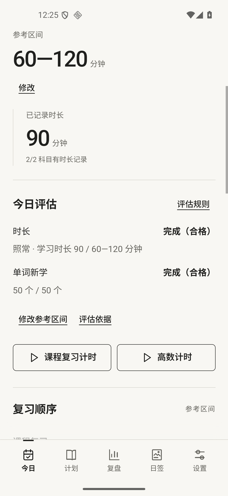
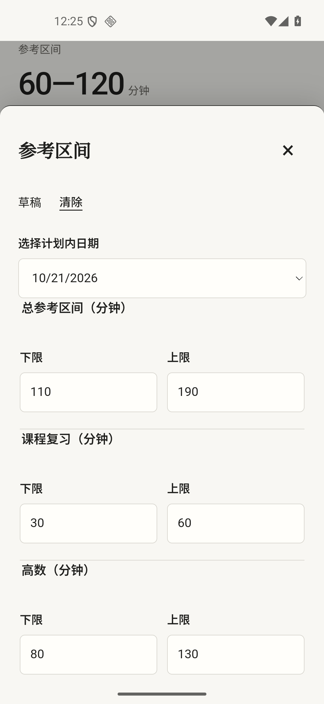

# v1.5.3：自动参考区间与今日评估修复

2026年10月21日，versionCode16。基线 v1.5.2/code15，提交0b2dce3；开始时工作区干净。数据格式仍为schema6。

**修复与操作变化**

旧算法把正数单值参考判成缺少区间；目标表单又默认保留旧评估依据，导致修改目标后仍显示“未设置参考区间”。JS与Java现将旧单值作为相同上下限评估，当前及未来日期自动补齐参考区间；课程复习与高数按现有安排生成，明确区间保留，自定义单值保留原数值。

今日总区间的“修改”、复习顺序中的数值和科目记录旁的参考均打开同一个编辑表单。改总区间会按现有分配调整分项，改分项会更新合计。整分钟总量按整分钟分配，单科上限1440分钟；单词目标单独设置。目标保存默认按新目标评估，可明确选择保留有效原依据。

当前及未来记录中旧单值或全零的时长依据，在现行目标有效时修复为当前区间，独立单词依据保留。既有有效区间依据不自动替换，过去日期的目标和依据不重写。过去单值现在可评级，原先因格式被排除的日期可能进入评估汇总；实际分钟、词数及其统计口径不变。

正常与减量安排会计入零参考科目已记录的实际分钟；空白零参考科目不强制填写。仅回顾仍只计算课程复习，休息保留实际值。目标编辑保留学习输入、原输入基线和草稿；失败可重试，重复保存不重复写入，过期表单拒绝覆盖新记录。自定周末区间只有与实际上下限一致时才显示原上午、下午安排。

**主要文件**

| 文件 | 修改 |
|---|---|
| reference.js / Reference.java | 单值兼容、时长计入、旧依据修复；JS总区间分配 |
| schedule.js / CourseSchedule.java | 自动区间生成，保留手动目标 |
| model.js / DataStore.java | 加载迁移接入自动区间与依据修复 |
| app.js / polish.css | 各处编辑入口、总分项联动、默认重评、失败/并发/草稿保护与布局 |
| manual.js / 使用说明.md / README.md | 同步实际操作与当前版本 |
| AndroidManifest.xml | 1.5.3/code16，沿用原签名 |
| reference-auto.test.cjs / reference-auto-ui.cjs / AutoReferenceTests.java | 本轮模型、WebView及原生回归 |
| assessment-history-ui.cjs / shared fixtures / ReleasePolishTests.java | 更新默认重评及单值评级断言 |

**验证结果**

| 验证 | 结果 |
|---|---|
| Node模型测试 | 127项通过；基线118项通过 |
| 原生SmokeTests | 558项通过，instrumentation code -1 |
| 自动区间与编辑UI | 50项通过，包括真实文件写入失败、重试、重复保存、并发实际记录、草稿、全零依据、多计划和后台返回 |
| 历史评估UI | 33项通过，保留依据、明确重评、失败恢复、筛选与统计 |
| 启动更新UI | 41项通过，包括迟到回调、下载状态、输入与计时保护 |
| 使用手册UI | 29项通过，离线、目录、大字号与后台返回 |
| v1.5.2 → v1.5.3正式覆盖 | 15项通过，最终正式包已实装，原文件恢复 |
| 布局与可访问名称 | 320 CSS像素、系统200%字号通过；编辑按钮名称与44px触控尺寸通过 |
| 构建 | build.ps1 -TestBuild / build.ps1成功 |
| 发行工具与安装包 | 39项通过；26个assets与工作区逐字节一致，正式包不含测试入口 |

报告：[模型](validation-v1.5.3/node-test-results.txt)、[原生](validation-v1.5.3/native-test-results.txt)、[区间UI](validation-v1.5.3/reference-auto-ui-results.json)、[历史UI](validation-v1.5.3/assessment-history-ui-results.json)、[启动更新](validation-v1.5.3/startup-update-ui-results.json)、[手册](validation-v1.5.3/manual-ui-results.json)、[覆盖升级](validation-v1.5.3/formal-upgrade-results.json)。所有设备回归使用专用Android16模拟器，结束后逐字节恢复原文件与原字号。

本轮未进行vivo X100s实际操作、TalkBack语音及手势验证，也未在Android8—15运行。旧单值由不可评级变为可评级的变化已在上文说明。用户手机中的原始数据未读取；根因通过代码与旧数据夹具复现，相关路径已回归。

正式APK为6,601,149字节，SHA-256为`671a1ee92322fed14c67af63498bcf23b922764dd884a4da2427ae1d54d7b9ee`。签名摘要为`fa74d9cbf26f6d34709400a576b93442b8295bdb607e7f80753669133244c3b5`。最终模拟器实装1.5.3/code16，9个原文件及1.0字号已再次核对，模拟器关闭。详见[安装包内容](validation-v1.5.3/apk-source-results.json)、[最终设备核对](validation-v1.5.3/final-device-results.json)、[发行工具](validation-v1.5.3/release-tooling-results.txt)。

**页面截图**

| 今日评估 | 参考区间编辑 |
|---|---|
|  |  |

[200%字号今日页](screenshots/v1.5.3/reference-auto-320px-200pct.png) · [200%字号区间编辑](screenshots/v1.5.3/reference-auto-editor-320px-200pct.png) · [正式版本](screenshots/v1.5.3/formal-upgrade-about.png)

**发行核验**

[GitHub v1.5.3](https://github.com/gaspainting/daily-study/releases/tag/v1.5.3)已公开发布，包含APK、update.json和RELEASE-NOTES.md。发行标签对应实现提交243a9d679c8eaafff4157424694c222d000291bd。新旧仓库名的latest/download/update.json均返回1.5.3/code16；从客户端兼容地址下载的APK与本地正式包大小和SHA-256一致，见[公开发行核对](validation-v1.5.3/public-release-results.json)。

本地交付目录为父目录output/android，包含安装包、源码ZIP、验证资料ZIP、使用说明和交付核对JSON。源码不包含签名私钥。
