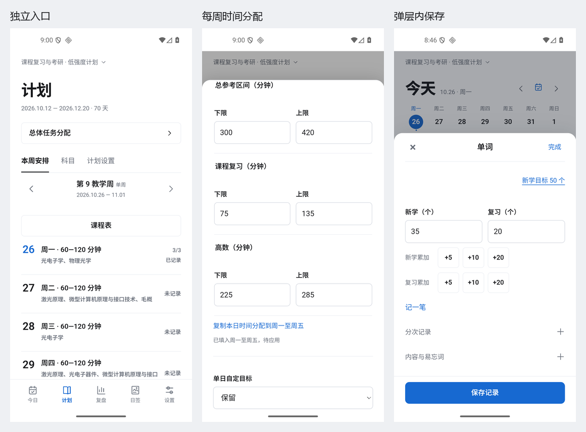

# 每日学习 v1.6.5

版本：v1.6.5 / versionCode22，数据schema8。设计与执行范围见[设计说明](DESIGN-v1.6.5.md)。

**总体任务分配**

独立入口：**计划 → 总体任务分配**，位于页面模块上方。

- 单词：修改每天的新学目标，例如50改为40；复习数量单独记录。
- 时间：按周一至周日修改总参考区间及科目分项，二者联动；可把当前星期的时间分配复制到周一至周五。
- 数量：按科目和单位修改每周默认目标。
- 选择生效日期；本次修改应用到该日起相关科目和星期，新增日期沿用新默认。
- 单日自定目标可保留或覆盖；已记录日期可按新目标评估或保留原依据。应用前列出实际日期、目标修改数量、评估数量和保留项。

本次只更新涉及科目的评估维度，生效日前及缩短计划后保留的历史依据、实际学习时长、词数、数量、随记和计时明细保留。不同数量单位的目标跳过并列出数量。各计划分别设置。

**记录与交互**

- 今日单词列表直接进入“记一笔”，加入后仍待保存。
- 科目、今日安排、随记弹层增加“保存记录”，提交整个今日表单；成功后返回列表，失败在弹层显示重试。标题“完成”及系统返回保持关闭编辑的作用。
- 页面导航记忆滚动位置，今日按日期区分。
- 窄屏、大字号允许文字换行；实际软键盘弹出时保持当前字段可见。
- 错误星期与字段自动展开，总区间或分项无效时拒绝应用。

**代码与文案**

| 文件 | 变化 |
|---|---|
| allocation.js | 分配转换、历史冻结、单日目标处理、涉及维度重评；候选状态在确认前不写入 |
| allocation-ui.js | 单词、时间和数量集中表单，总分项联动、星期复制、输入定位及范围确认 |
| app.js | 独立入口、原生确认和单次保存、草稿与版本冲突检查、编辑内保存及页面位置 |
| layout.js / layout.css | 列表记一笔、弹层保存与重试、窄屏和键盘衔接 |
| manual.js | 总体分配、快捷记录、保存和新版设置路径 |

新增/变化标签为“总体任务分配”“生效日期”“单日自定目标”“已记录日期的评估”“应用分配”。复制反馈为“已填入周一至周五，待应用”；原生写入确认后才显示“分配已应用”或“已保存”。

**验证**

| 范围 | 已执行结果 |
|---|---|
| 模型 | 193项通过，其中15项新增分配测试 |
| Android原生 | 626项通过，导出PDF与CSV样例 |
| 总体任务分配与编辑操作 | 40项通过 |
| 白底列表 | 65项通过 |
| 布局导航 | 116项通过 |
| 数量记录 | 66项通过 |
| 单词分次 | 48项通过 |
| 使用手册 | 29项通过 |
| 启动更新 | 44项通过 |
| 正式覆盖升级 | 20项通过 |
| 发行工具 | 39项通过 |

命令与各套结果见[执行汇总](validation-v1.6.5/run-summary.json)和[验证目录](validation-v1.6.5/)。构建执行 `build.ps1 -TestBuild`、`build.ps1`；模型执行 `node --test tests/*.test.cjs`；原生执行 `COURSE_NATIVE_ONLY=1 node tests/course-agenda-fix-ui.cjs`，PowerShell使用 `$env:COURSE_NATIVE_ONLY=1` 设置环境变量。

设备检查使用专用Android16模拟器，脚本驱动真实WebView，另外使用Android控件操作确认框、软键盘及正式包。v1.6.4/code21覆盖到本版，并在正式包内把50个改为40个，核对未来目标和当前评估。原有28份应用文件与偏好恢复，字体还原，正式包32个资产与源码逐字节一致。

vivo X100s、TalkBack语音与手势、Android8—15未实测。

**页面截图**

- [总体入口](screenshots/v1.6.5/allocation-entry.png)
- [总体分配](screenshots/v1.6.5/allocation-editor.png)、[参考时间](screenshots/v1.6.5/allocation-time.png)
- [应用后的今日](screenshots/v1.6.5/allocation-today.png)
- [320px / 200%分配表单](screenshots/v1.6.5/allocation-320px-200pct.png)
- [编辑内保存](screenshots/v1.6.5/record-save-320px-200pct.png)、[实际软键盘](screenshots/v1.6.5/record-keyboard-320px-200pct.png)

安装与操作见[使用说明](使用说明.md)，发行说明见[RELEASE-NOTES-v1.6.5](RELEASE-NOTES-v1.6.5.md)。

**发行信息**

- v1.6.5 / versionCode22，schema8，最低Android8.0。
- APK：6,638,403字节；SHA256：`3df8e79f46f44577e1bcdf02416e4130f8a58689c86be3b41de9a773ee085170`。
- 延续现有正式签名。[GitHub发行页](https://github.com/gaspainting/daily-study/releases/tag/v1.6.5)。
